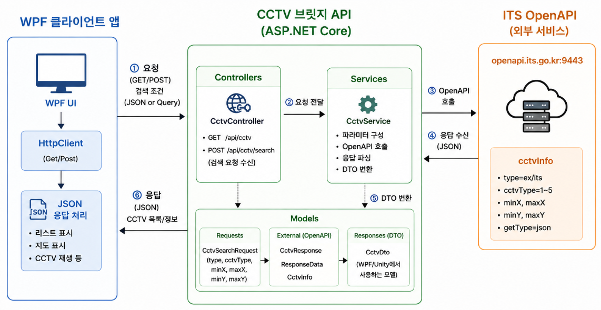
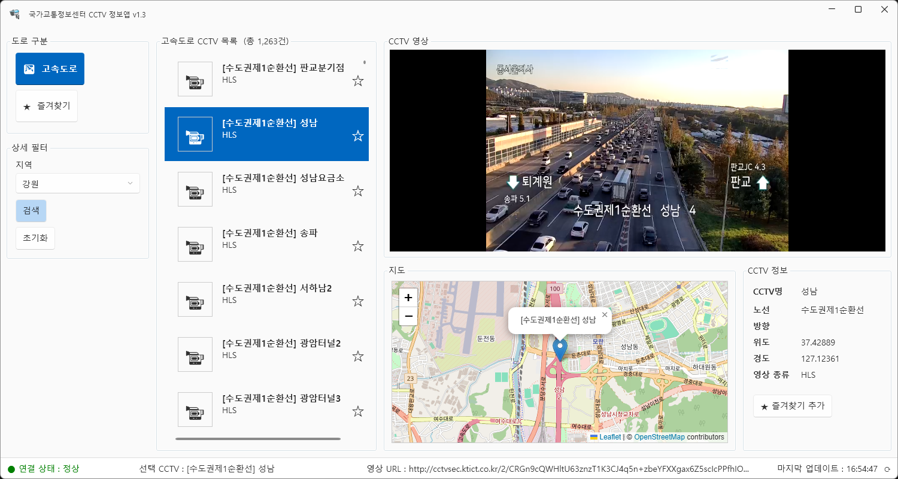
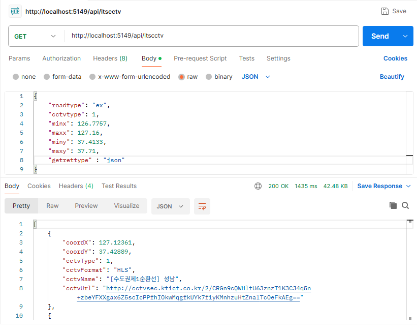

# 교통 CCTV 모니터링 시스템

> WPF와 ASP.NET Core Web API를 연동하여 교통 CCTV 조회, 영상 재생, 지도 기반 위치 확인을 제공하는 데스크톱 애플리케이션

## 프로젝트 개요

| 구분 | 내용 |
| --- | --- |
| 프로젝트명 | CCTV Monitor |
| 구현 범위 | 지역별 CCTV 조회, 영상 재생, 지도 연동, 상세정보 및 연결 상태 표시 |
| 클라이언트 | C#, .NET 10, WPF, WPF UI |
| API 서버 | ASP.NET Core Web API |
| 외부 데이터 | ITS 국가교통정보센터 OpenAPI |
| 영상 재생 | LibVLCSharp.WPF, VideoLAN.LibVLC.Windows |
| 지도 | WebView2, Leaflet, OpenStreetMap |
| 데이터 통신 | HTTP, JSON, HttpClient, Newtonsoft.Json |

## 프로젝트 소개

지역별 교통 CCTV를 조회하고, 선택한 CCTV의 영상과 위치를 한 화면에서 확인할 수 있는 모니터링 시스템입니다.

WPF 클라이언트는 사용자가 선택한 도로 구분과 지역 정보를 API 서버에 전달합니다. ASP.NET Core 기반 브릿지 API는 ITS 국가교통정보센터 OpenAPI를 호출하고, 조회 결과를 클라이언트에서 사용하는 데이터 구조로 변환하여 반환합니다.

클라이언트에서는 CCTV 목록과 상세정보를 표시하고, LibVLCSharp로 영상을 재생합니다. WebView2 안에 Leaflet 지도를 표시하여 선택한 CCTV의 좌표를 마커로 확인할 수 있도록 구성했습니다.

## 주요 기능

### 1. 지역별 CCTV 검색

- 고속도로·국도 구분 선택
- 지역별 위도·경도 범위를 이용한 CCTV 조회
- 검색 결과 목록과 전체 건수 표시
- 검색 중 로딩 표시 및 검색 버튼 비활성화

### 2. CCTV 영상 재생

- 목록에서 선택한 CCTV의 영상 URL로 재생 요청
- LibVLCSharp 기반 스트리밍·동영상 재생
- 다른 CCTV 선택 시 이전 영상 정지 후 새 영상 재생
- 재생 이벤트와 오류 이벤트에 따른 연결 상태 표시

### 3. 지도 기반 위치 확인

- WebView2를 이용한 Leaflet 지도 표시
- CCTV 위도·경도를 이용한 위치 마커 생성
- CCTV 선택 시 지도 중심 이동 및 확대
- 마커 팝업에 CCTV 이름 표시

### 4. 상세정보 및 상태 표시

- CCTV 이름, 도로명, 방향, 좌표, 영상 형식 표시
- 상태표시줄에 선택한 CCTV와 영상 URL 표시
- 연결 상태에 따른 상태 문구 및 색상 변경
- 초기화 버튼으로 검색 조건, 목록, 영상, 지도 및 상세정보 초기화

### 5. 브릿지 API 연동 및 예외 처리

- 외부 OpenAPI 호출을 ASP.NET Core 서버로 분리
- 조회 결과를 DTO로 변환하여 WPF 클라이언트에 전달
- 지역 미선택, 조회 실패, 영상 재생 오류 처리
- 앱 종료 시 VLC 플레이어와 관련 리소스 해제

## 시스템 구조



| 구성 요소 | 역할 |
| --- | --- |
| WPF 클라이언트 | 검색 조건 입력, CCTV 목록·상세정보 표시, 영상 재생, 지도 표시 |
| ASP.NET Core 브릿지 API | 검색 요청 수신, 외부 OpenAPI 호출, 응답 데이터 변환 |
| ITS OpenAPI | CCTV 이름, 좌표, 영상 URL 등 CCTV 정보 제공 |
| CCTV 영상 서버 | 클라이언트가 재생할 영상 스트림 제공 |
| OpenStreetMap | Leaflet 지도에 사용할 배경 지도 타일 제공 |

브릿지 API는 CCTV 정보를 중계하며, 영상은 반환된 영상 URL을 이용해 클라이언트에서 재생합니다.

## 주요 화면

### CCTV 모니터링 화면



검색 결과에서 CCTV를 선택하면 영상, 지도 위치, 상세정보를 함께 표시합니다. 지도 마커로 CCTV의 위치와 이름을 확인하고, 상세정보 영역에서 도로 정보, 좌표 및 영상 형식을 확인할 수 있습니다.

### 브릿지 API 조회 결과



ASP.NET Core API에서 외부 CCTV 조회 결과를 JSON 형식으로 반환한 화면입니다.

## 데이터 흐름

1. 사용자가 도로 구분과 지역을 선택하고 검색합니다.
2. WPF 클라이언트가 선택한 지역의 위도·경도 범위로 검색 요청을 생성합니다.
3. 브릿지 API가 요청 조건을 받아 ITS OpenAPI를 호출합니다.
4. 외부 응답을 클라이언트용 DTO 목록으로 변환하여 반환합니다.
5. WPF 클라이언트가 CCTV 목록과 검색 건수를 갱신합니다.
6. 사용자가 CCTV를 선택하면 영상 URL로 재생을 시작합니다.
7. 선택한 CCTV의 좌표로 지도 마커를 이동하고 상세정보와 상태표시줄을 갱신합니다.

## 주요 구현 내용

### 외부 API와 화면 처리 분리

외부 OpenAPI 호출은 `ItsCctvBridgeApi`에서 처리하고, WPF 클라이언트는 브릿지 API가 반환한 데이터를 화면에 표시하도록 구성했습니다.

서버는 Controller·Service·Model로 역할을 나누고, 클라이언트는 공통 설정, 데이터 모델, 서비스 호출 코드를 분리했습니다. `CctvRequest`와 `CctvResultDto`를 통해 검색 조건과 응답 데이터를 전달합니다.

### 지역별 좌표 범위 검색

지역별 최소·최대 위도와 경도를 `GeoBound`로 관리합니다. 사용자가 지역을 선택하면 해당 범위를 검색 요청에 반영하여 CCTV 목록을 조회합니다.

### 영상·지도·상세정보 연동

CCTV 선택 이벤트에서 영상 재생, 지도 마커 이동, 상세정보 및 상태표시줄 갱신을 연결했습니다. 하나의 선택 결과를 기준으로 관련 화면을 함께 갱신하도록 구현했습니다.

### 비동기 조회와 리소스 관리

CCTV 조회는 비동기 방식으로 처리하고, 검색 중에는 로딩 화면을 표시하며 중복 검색을 제한합니다. 영상 재생 상태를 이벤트로 반영하고, 앱 종료 시 플레이어와 VLC 객체를 해제합니다.

## 문제 해결

### OpenStreetMap 지도 타일 접근 오류

지도 타일이 `403 Access blocked`로 표시되는 문제가 발생했습니다. WebView2의 지도 로딩 방식을 로컬 HTML 파일과 가상 호스트 매핑을 사용하는 방식으로 변경하고, 요청 식별 정보·타일 URL·출처 표시를 보완했습니다. 수정 후 지도와 CCTV 위치 마커가 정상적으로 표시되는 것을 확인했습니다.

## 기술 스택

| 구분 | 기술 | 활용 내용 |
| --- | --- | --- |
| Language | C# | 클라이언트 및 API 서버 구현 |
| Framework | .NET 10 | 애플리케이션 실행 환경 |
| Desktop UI | WPF, WPF UI | 모니터링 화면 및 메시지 UI 구성 |
| Backend | ASP.NET Core Web API | CCTV 조회 요청 처리 및 외부 API 중계 |
| Video | LibVLCSharp.WPF, VideoLAN.LibVLC.Windows | CCTV 영상 재생 |
| Browser | Microsoft.Web.WebView2 | WPF 내부 지도 웹 화면 표시 |
| Map | Leaflet, OpenStreetMap | 지도 표시 및 CCTV 위치 마커 관리 |
| Communication | HttpClient, HTTP, JSON | 클라이언트·서버 및 외부 API 통신 |
| Serialization | Newtonsoft.Json | JSON 직렬화·역직렬화 |
| Tool | Visual Studio, NuGet | 프로젝트 빌드 및 패키지 관리 |

## 프로젝트 구조

| 경로 | 내용 |
| --- | --- |
| `CctvMonitor.slnx` | WPF 클라이언트와 API 서버를 포함한 솔루션 |
| `WpfCctvMonitorApp/` | WPF 클라이언트 프로젝트 |
| `WpfCctvMonitorApp/Common/` | 공통 설정 및 지역별 좌표 범위 |
| `WpfCctvMonitorApp/Models/` | CCTV 검색 요청·응답 모델 |
| `WpfCctvMonitorApp/Services/` | 브릿지 API 호출 서비스 |
| `ItsCctvBridgeApi/` | ASP.NET Core API 서버 프로젝트 |
| `ItsCctvBridgeApi/Controllers/` | CCTV 조회 API 컨트롤러 |
| `ItsCctvBridgeApi/Services/` | 외부 OpenAPI 호출 및 결과 변환 |
| `ItsCctvBridgeApi/Models/` | 외부 응답 모델 및 DTO |
| `images/` | 시스템 구성도 및 실행 화면 |
| `README.md` | 프로젝트 소개 및 실행 방법 |

## 주요 소스

| 소스 | 역할 |
| --- | --- |
| [MainWindow.xaml](./WpfCctvMonitorApp/MainWindow.xaml) | 검색 조건, CCTV 목록, 영상·지도 영역 구성 |
| [MainWindow.xaml.cs](./WpfCctvMonitorApp/MainWindow.xaml.cs) | 검색·선택 이벤트, 영상 재생, 지도 연동 및 상태 갱신 |
| [GeoBound.cs](./WpfCctvMonitorApp/Common/GeoBound.cs) | 지역별 위도·경도 범위 모델 |
| [AppCommon.cs](./WpfCctvMonitorApp/Common/AppCommon.cs) | 지역 정보, API 주소 등 공통 값 관리 |
| [클라이언트 ItsCctvService.cs](./WpfCctvMonitorApp/Services/ItsCctvService.cs) | 검색 요청 전송 및 응답 역직렬화 |
| [ItsCctvController.cs](./ItsCctvBridgeApi/Controllers/ItsCctvController.cs) | CCTV 조회 요청 수신 및 응답 반환 |
| [서버 ItsCctvService.cs](./ItsCctvBridgeApi/Services/ItsCctvService.cs) | ITS OpenAPI 호출 및 응답 데이터 처리 |
| [Program.cs](./ItsCctvBridgeApi/Program.cs) | API 서버 구성 및 서비스 등록 |

## 실행 전 설정

- Windows와 .NET 10 SDK가 필요합니다.
- `.slnx`와 .NET 10을 지원하는 Visual Studio를 사용합니다.
- WebView2 Runtime이 필요합니다.
- ITS 국가교통정보센터의 CCTV OpenAPI 인증키가 필요합니다.
- 외부 API, 영상 서버 및 지도 리소스에 접속할 수 있는 네트워크 환경이 필요합니다.

### API 인증키

`ItsCctvBridgeApi/appsettings.json`의 `ItsOpenApi` 설정에 발급받은 인증키를 지정합니다.

```json
"ItsOpenApi": {
  "BaseUrl": "https://openapi.its.go.kr:9443/cctvInfo",
  "ApiKey": "YOUR_ITS_API_KEY"
}
```

현재 클라이언트는 브릿지 API를 호출하므로, ITS 인증키는 API 서버에서 설정합니다.

### 서버 주소

`WpfCctvMonitorApp/Common/AppCommon.cs`의 `baseUrl`이 API 서버 실행 주소와 일치하는지 확인합니다. 서버 포트는 `ItsCctvBridgeApi/Properties/launchSettings.json`에서 확인할 수 있습니다.

## 실행 방법

1. Visual Studio에서 `CctvMonitor.slnx`를 엽니다.
2. NuGet 패키지를 복원하고 솔루션을 빌드합니다.
3. `ItsCctvBridgeApi`를 먼저 실행하고 서버를 켜둡니다.
4. `WpfCctvMonitorApp`을 실행합니다.
5. 고속도로·국도와 지역을 선택한 뒤 검색합니다.
6. 목록에서 CCTV를 선택하여 영상, 지도 위치 및 상세정보를 확인합니다.

Visual Studio의 여러 시작 프로젝트 설정에서 API 서버와 WPF 앱을 모두 시작하도록 구성할 수도 있습니다.

## 구현 결과

- ASP.NET Core 브릿지 API와 WPF 클라이언트 연동
- 지역·도로 구분에 따른 CCTV 목록 조회
- CCTV 선택에 따른 영상 재생 및 지도 마커 표시
- 상세정보와 연결 상태를 함께 표시하는 모니터링 화면 구성
- OpenStreetMap 타일 차단 문제에 대한 지도 로딩 방식 개선

## 향후 개선사항

- 즐겨찾기 저장 및 조회 기능 추가
- 검색 결과가 많은 지역의 목록 표시 및 검색 성능 개선
- 영상 연결 실패 시 재시도 및 사용자 안내 개선
- API 주소와 인증키 등 실행 설정 관리 개선
- 지도 초기화 및 로딩 완료 처리 보강

## 참고 자료

- [ITS 국가교통정보센터](https://www.its.go.kr/)
- [원본 학습 문서](https://github.com/Haluey/iot-dotnet-2026/blob/main/TOYPROJECT1.md)
- [Leaflet](https://leafletjs.com/)
- [OpenStreetMap](https://www.openstreetmap.org/)
- [OpenStreetMap Tile Usage Policy](https://operations.osmfoundation.org/policies/tiles/)
